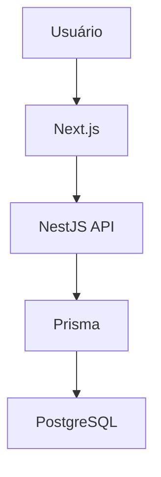

# DeskFlow

> Gestão de suporte técnico e chamados para pequenas e médias equipes.

   

## Sobre o projeto

DeskFlow é uma plataforma SaaS de help desk projetada para centralizar solicitações de suporte, organizar responsabilidades e acompanhar o desempenho do atendimento. O projeto busca resolver problemas comuns em empresas que recebem demandas por canais dispersos, sem responsáveis definidos, prazos claros ou histórico de resolução.

A proposta é oferecer uma experiência objetiva, acessível e responsiva, com interfaces específicas para cada perfil de usuário. O produto é inspirado em soluções consolidadas de mercado, com implementação e identidade visual próprias.

## Funcionalidades planejadas (MVP)

- Autenticação e gerenciamento de organizações, usuários e permissões.
- Abertura de chamados com protocolo, categoria e prioridade.
- Filas de atendimento, filtros, pesquisa e atribuição de responsáveis.
- Comunicação pública e notas internas da equipe.
- Fluxo de status, histórico de alterações e linha do tempo.
- Dashboard interativo com indicadores e acesso às filas correspondentes.
- Administração de equipes, categorias e membros.

### Evoluções previstas

SLA, notificações, base de conhecimento, anexos, exportação CSV, avaliação CSAT, respostas rápidas, busca global, configuração guiada e distribuição automática de demandas.

## Perfis de acesso

| Perfil | Responsabilidade |
| --- | --- |
| Solicitante | Abrir e acompanhar seus próprios chamados. |
| Atendente | Organizar a fila, responder e resolver demandas. |
| Gestor | Supervisionar equipes, chamados e indicadores. |
| Administrador | Gerenciar membros, permissões e configurações. |

## Stack tecnológica planejada

| Camada | Tecnologias |
| --- | --- |
| Front-end | Next.js, React, TypeScript, Tailwind CSS, shadcn/ui |
| Back-end | Node.js, NestJS, REST, Swagger/OpenAPI |
| Banco de dados | PostgreSQL e Prisma ORM |
| Monorepo | pnpm e Turborepo |
| Qualidade | Vitest, Jest, Playwright, ESLint e Prettier |
| Infraestrutura | Docker Compose e GitHub Actions |
| Hospedagem | Vercel (web), Render (API), Supabase (PostgreSQL); Upstash/Redis quando necessário |

## Arquitetura proposta

O back-end será um monólito modular, com regras de negócio e autorização centralizadas na API. Cada organização terá isolamento de dados, e as alterações relevantes serão registradas em auditoria.

## Roadmap

- [x] Planejamento e especificação de requisitos v1.1.
- [x] Pesquisa de concorrentes e referências técnicas.
- [x] Identidade visual e seleção do logotipo.
- [ ] Design System e protótipo navegável.
- [ ] Configuração do monorepo e infraestrutura local.
- [ ] Implementação do back-end.
- [ ] Implementação do front-end definitivo.
- [ ] Integração, testes e revisão de acessibilidade.
- [ ] Publicação da demonstração e release inicial.

## Referências técnicas

O planejamento considera práticas observadas em repositórios públicos de [Gustavo Guanabara](https://github.com/gustavoguanabara), [Rafaella Ballerini](https://github.com/rafaballerini), [Loiane Groner](https://github.com/loiane/crud-angular-spring), [Fabio Akita](https://github.com/akitaonrails/ai-memory), [Zeno Rocha](https://github.com/zenorocha/clipboard.js), [Mario Souto](https://github.com/devsoutinho/mariosouto.com.monorepo) e [Guilherme Silveira](https://github.com/guilhermesilveira). As referências são utilizadas para estudo de boas práticas, sem alegação de vínculo ou endosso.

## Execução local

A base visual do produto está em evolução. Consulte também [Front-end do produto](docs/frontend-product.md) para a preparação da integração com a API. Consulte [Design System](docs/design-system.md) para componentes, escopo e instruções. Com Node.js 22+ e pnpm 10.4.1, execute `pnpm install` e `pnpm dev`, depois abra http://localhost:3000. O login, a seleção de organização e o espaço de trabalho por perfil usam dados fictícios em memória; não são autenticação ou persistência reais. O catálogo permanece em /design-system. Consulte também [Arquitetura e API](docs/architecture.md) para a fundação NestJS e o esquema Prisma.

## Autor

Desenvolvido por [Saulo Gabriel](https://github.com/sauloz20) como projeto de portfólio e engenharia de software.
